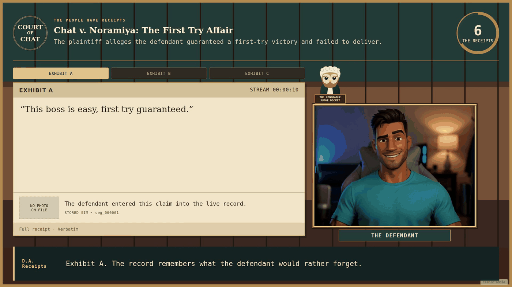
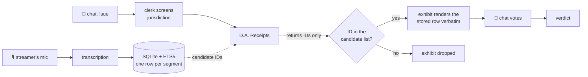
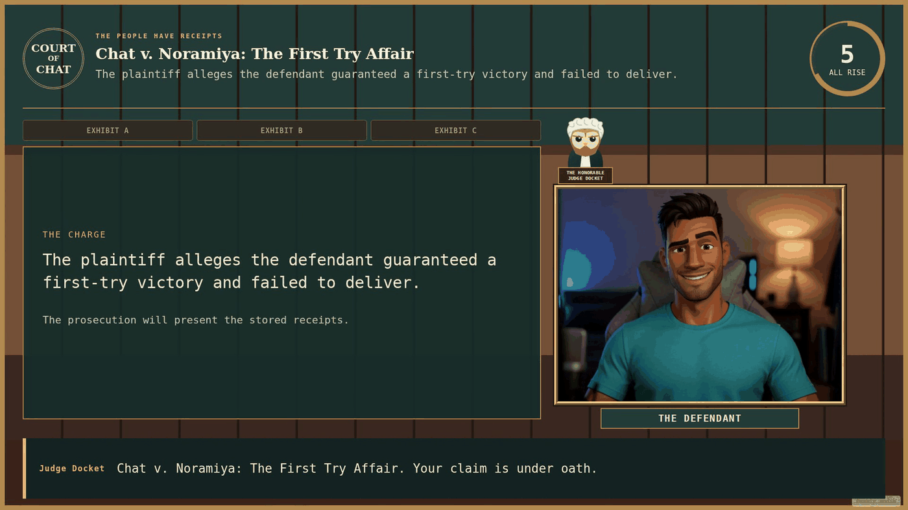
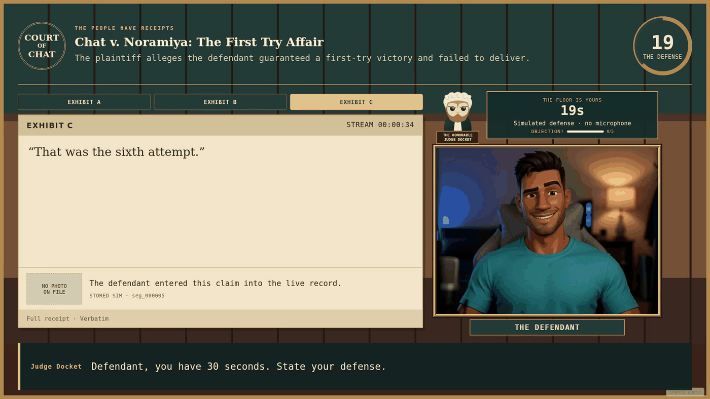
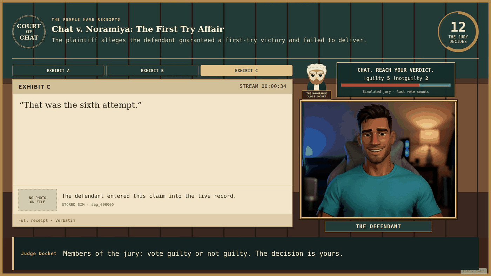
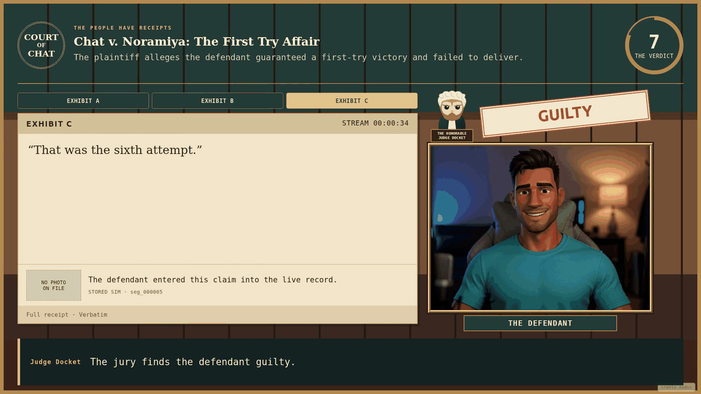
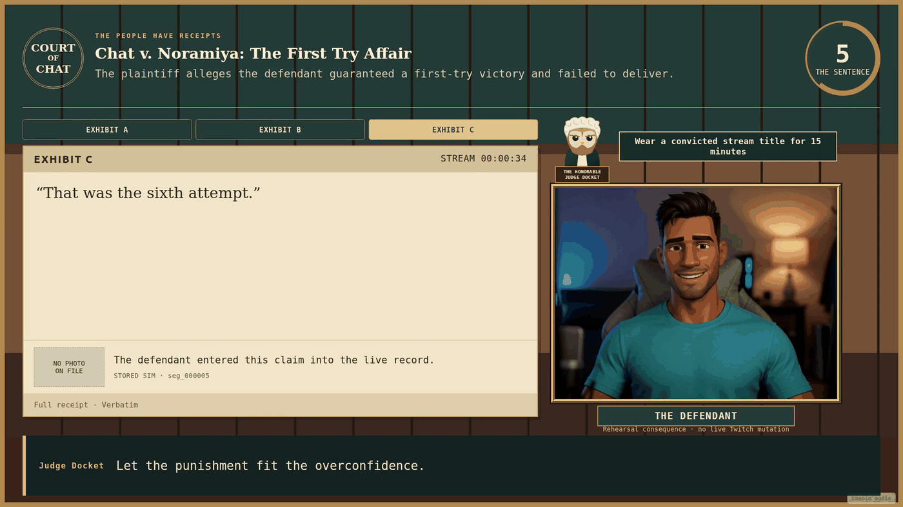
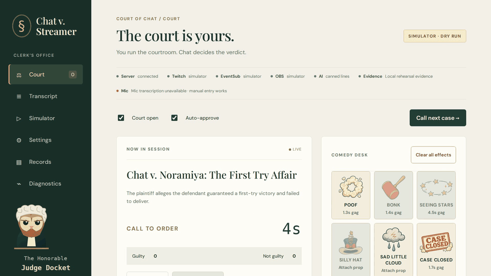
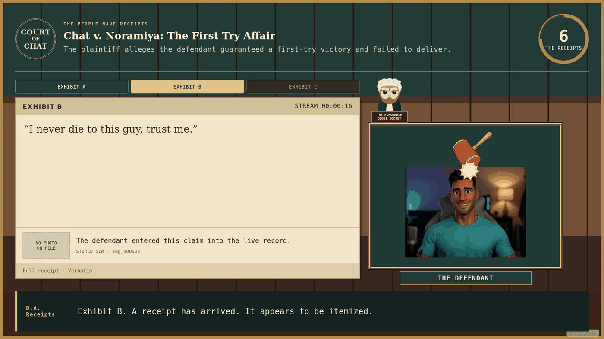
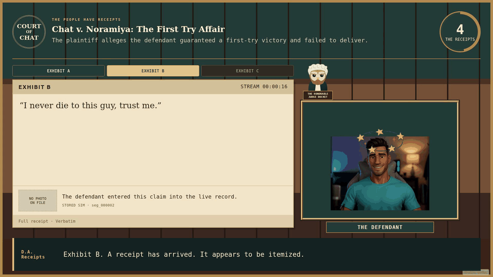

<div align="center">

# Chat v. Streamer

**A Twitch courtroom where chat sues the streamer.**
The evidence is your own words, transcribed live. Chat is the jury. The sentence is real.




</div>

---

A viewer types `!sue`. Two more `!cosign`. A clerk decides whether the court has jurisdiction, and
then D.A. Receipts builds a case **out of the streamer's own voice** — pulled from a live
transcript of the stream. The streamer gets thirty seconds to explain themselves into their own
microphone. Chat votes. A guilty verdict rewrites the stream title to `[CONVICTED] …` for fifteen
minutes, then puts the original back.

Judge Docket is an owl in a wig. He is not impressed with you.

## Try it

**Live demo: [chat-v-streamer.fly.dev/panel](https://chat-v-streamer.fly.dev/panel)** — press
**Run full demo trial** and watch
[the overlay](https://chat-v-streamer.fly.dev/overlay) in a second tab.

That instance is the simulator with no credentials of any kind: no Twitch tokens, no OpenAI key, so
the dialogue is the written fallback. Its database is ephemeral and one courtroom is shared by
everyone, so expect the occasional collision with another visitor.

### Or run it yourself in a minute

No Twitch account, no API key, no microphone.

```sh
npm install
npm run dev
```

Open **http://localhost:5173/panel** and click **Run full demo trial**.

The simulator files a case, adds co-signers, injects receipts and a defense, casts five guilty and
two not-guilty votes, applies a simulated title sentence and saves a precedent. For the stable OBS
URLs, `npm run build && npm start` and use port **8787**.

## The one rule everything hangs off

**The AI is never allowed to write a quote.**

Every word the streamer says is transcribed into local SQLite with full-text search, one row per
segment. When the prosecutor builds its case it returns **segment IDs, not text**. The server
validates each ID against the candidates it was actually shown, then renders the stored row
character for character.



Invent an ID and the exhibit is dropped. Invent all of them and the case is dismissed rather than
argued with fabricated evidence. The roast is always something you really said — which is what
makes it funny, and what makes it safe to run unattended.

The jury is chat and only chat. One vote per account, last vote counts, ties acquit, zero votes is
a mistrial. No model output can change a verdict.

## A trial, end to end

<table>
<tr>
<td width="50%"></td>
<td width="50%"></td>
</tr>
<tr>
<td><b>Call to order.</b> The clerk's formal charge goes up. Pacing is 94&ndash;110 seconds, with a hard 180-second ceiling enforced inside the reducer.</td>
<td><b>The defense.</b> Thirty seconds, captured from the real microphone and transcribed as you speak. Chat can spam <code>!objection</code>; enough of them and the gavel comes down.</td>
</tr>
<tr>
<td></td>
<td></td>
</tr>
<tr>
<td><b>The jury.</b> Twenty seconds. One vote per account, the last one counts. The AI learns the result only after chat has decided it.</td>
<td><b>The verdict.</b> Announced immediately from a fixed line &mdash; it never waits for a model.</td>
</tr>
</table>

<div align="center">



</div>

**The sentence.** The title becomes the crime for fifteen minutes. The original was saved first and
the restore job is on disk, so a crash still restores it.

## Chat commands

| Command                            | Who                      | Effect                                     |
| ---------------------------------- | ------------------------ | ------------------------------------------ |
| `!sue <charge>`                    | anyone                   | File a lawsuit                             |
| `!cosign [N]`                      | anyone but the plaintiff | Push a filing to the bench                 |
| `!guilty` · `!g`                   | anyone, during jury      | Vote guilty                                |
| `!notguilty` · `!ng` · `!innocent` | anyone, during jury      | Vote not guilty                            |
| `!objection`                       | anyone, during defense   | Fill the objection meter                   |
| `!docket` · `!record`              | anyone                   | Case names and the conviction record       |
| `!court on` · `!court off`         | broadcaster/mod          | Open or close filing                       |
| `!approve N` · `!veto N`           | broadcaster/mod          | Control pending cases                      |
| `!mistrial`                        | broadcaster/mod          | Abort, cancel sentences, restore the scene |
| `!strike A\|B\|C`                  | broadcaster              | Strike one exhibit per trial               |

## The streamer keeps control

A mistrial button that works at any moment and restores your OBS scene. One exhibit strike per
trial. Veto on any pending case, through the whole pretrial. A penal code where every punishment is
a JSON entry that does nothing until you mark it `approved: true` — only the title sentence ships
approved. `DRY_RUN` logs every outgoing Twitch action instead of performing it, and defaults on.

<div align="center">



</div>

## And a mallet

<div align="center">

 

</div>

Six original props, placed against a head position **you** calibrate — there is no face tracking
and nothing is guessed. The comedy desk lives in its own state domain: gags cannot touch votes,
approval, sentencing or `DRY_RUN`.

## Documentation

|                                            |                                                                  |
| ------------------------------------------ | ---------------------------------------------------------------- |
| [docs/SETUP.md](docs/SETUP.md)             | Twitch, OBS, OpenAI, microphone — and troubleshooting            |
| [docs/FEATURES.md](docs/FEATURES.md)       | Sentencing, records, jurisdiction, comedy desk, head calibration |
| [docs/DEVELOPMENT.md](docs/DEVELOPMENT.md) | Tests, browser checks, rehearsals, connected sign-off            |
| [AGENTS.md](AGENTS.md)                     | Architecture and the rules this codebase holds itself to         |
| [BUILD_LOG.md](BUILD_LOG.md)               | Every milestone, every decision, and what was _not_ proved       |

## Architecture

Node 20, strict TypeScript, no `any`. Express + `ws` + SQLite/FTS5 on the server; React and Vite
for the panel and the transparent 1920×1080 OBS overlay. ~12,000 lines across 82 files.

```
server/court/machine.ts   pure reducer — (state, event, settings) → {state, effects}
                          no I/O, no timers, injected clock, 180s ceiling lives here
server/court/runner.ts    coordinates persistence and effects around the reducer
server/ai/                Zod → strict JSON schemas, bounded deadlines, fail-closed
                          moderation, candidate-ID validation
server/adapters/          twitch · obs · transcript, each real + simulator
server/comedy/desk.ts     separate state domain, cannot reach court state
web/src/overlay/          receives sanitised snapshots only
web/src/panel/            raw filings and audit log live here, never on stream
```

Four boundaries do the work:

- **The reducer owns the clock.** Time is injected, so a complete eight-phase trial runs instantly
  in a test, and **no AI call can extend a trial** — the worst a slow model does is miss its slot
  and get a written line instead.
- **Every AI call is schema- and deadline-bound.** Four roles, each a Zod schema compiled to a
  strict JSON schema so validator and request come from one definition. 6s / 15s / 8s / 6s, one
  retry inside budget. Moderation fails closed.
- **Real and simulated adapters are explicit.** `SIM_MODE` and `DRY_RUN` both default true.
- **Raw chat never reaches the overlay.** Snapshots carry no raw filings, no audit log, no full
  transcript. Evidence is bound to a verified broadcast ID.

## Status

Everything described here is implemented. What has been run against a live service, and what has
not, is tracked deliberately — that distinction is part of the point.

|                                                 |                                                                                                                                                                                                                               |
| ----------------------------------------------- | ----------------------------------------------------------------------------------------------------------------------------------------------------------------------------------------------------------------------------- |
| Runs offline with no credentials                | **Verified.** 100 tests, `demo:check`, `browser:check` including per-pixel camera alpha                                                                                                                                       |
| Twitch OAuth, EventSub, Helix                   | **Built**, against Twurple and the official references. Contract-tested with a fake transport, plus dry-run guards, protected-user checks and disk-backed title-restoration tests across real, dry-run and simulator restarts |
| OBS WebSocket v5                                | **Built.** Exercised against a local v5 protocol fixture, including disconnect and restart recovery                                                                                                                           |
| OpenAI roles, moderation, speech, transcription | **Built.** Exercised against a local HTTP protocol fixture with the real SDK                                                                                                                                                  |
| Authenticated rehearsal on a live channel       | **Outstanding.** No live Twitch session, real OBS instance or physical microphone has run                                                                                                                                     |

That last row is why `BUILD_LOG.md` has a column headed _"real service actually exercised"_ reading
mostly **No**. Keeping it honest is what caught a dry-run rehearsal wrongly marking a real
title-restoration obligation complete — a bug you only find if you admit what you have not yet run.

## Built with OpenAI Codex

Codex wrote this, in one day, across ten milestones you can read in order — `M1` through `M10` in
`git log`. The habits are the interesting part: it read the installed type declarations before
authoring any API call, reproduced every bug and wrote the measurement down _before_ fixing it, and
drove Chromium to scan **every pixel inside the camera cutout** for an alpha of zero rather than
trusting a stylesheet.

## Assets

All character artwork is original SVG; the owl wears an original judge's wig. The six comedy props
were generated through Higgsfield GPT Image 2 using the original owl as a style reference, with
per-file crop coordinates, alpha counts and SHA-256 hashes recorded in
`web/public/comedy/provenance.json`. Gavel, sting, stamp and gasp are synthesised locally with
WebAudio. No franchise art or audio is included anywhere.

Audio generated at runtime is AI generated — disclose that to your audience.
